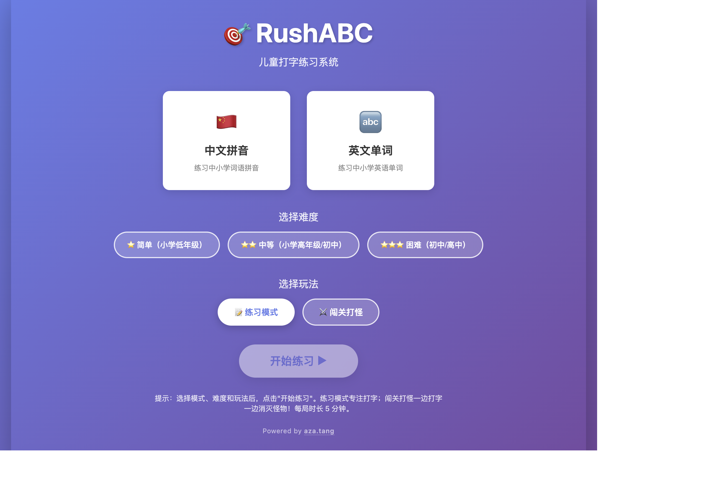
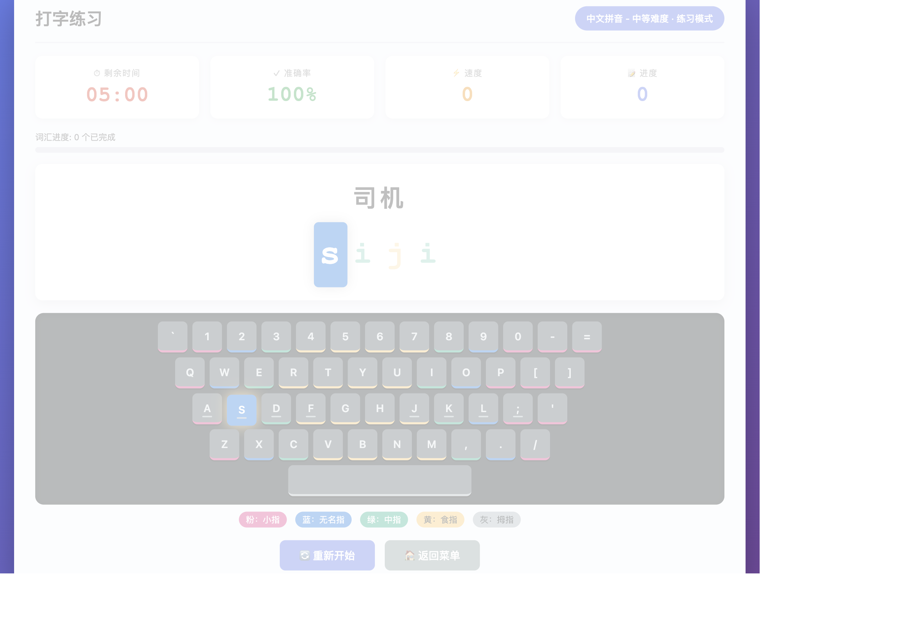
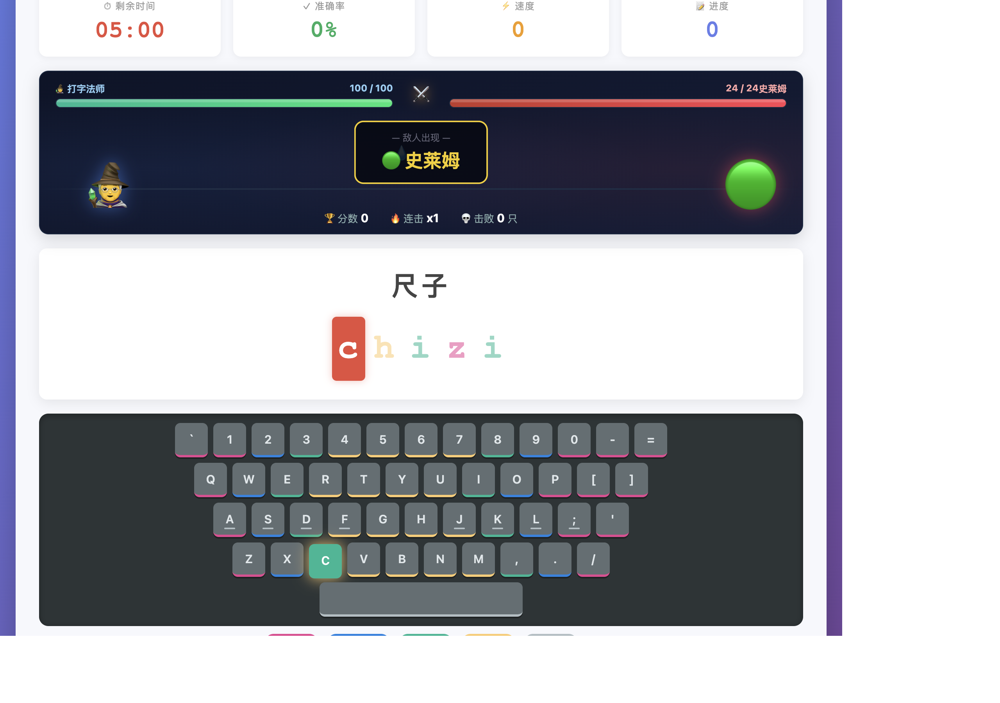
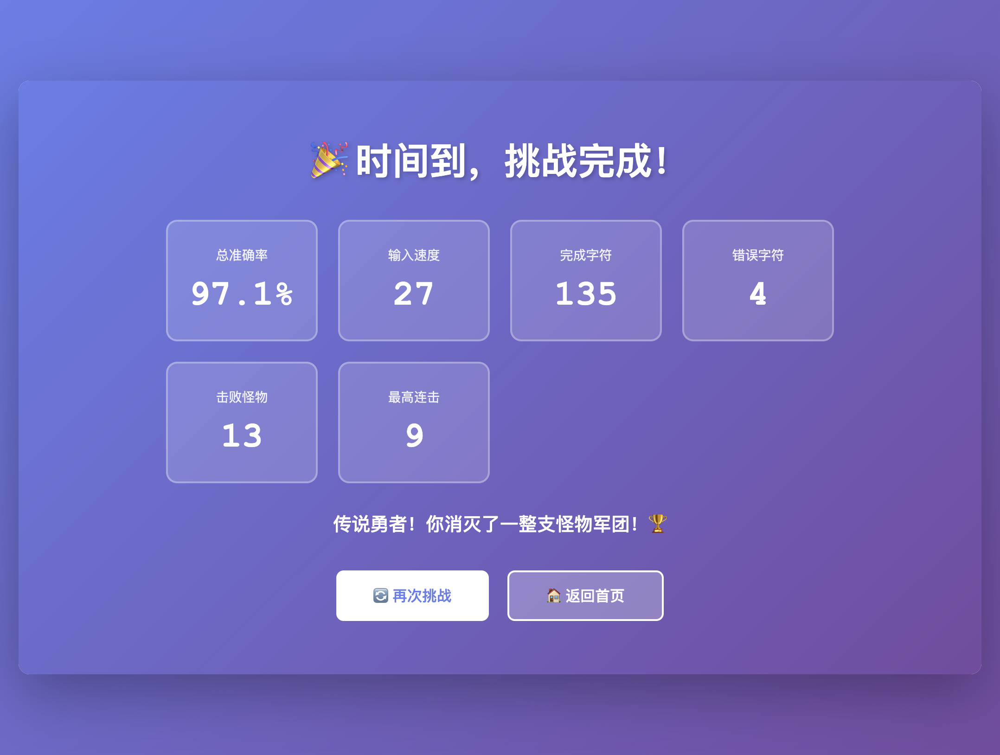

# 🎯 RushABC

**RushABC** is a fun, gamified typing practice app for kids — type pinyin or English words to defeat monsters, build combos, and improve your typing speed.

> Powered by [aza.tang](https://github.com/azatang)

---

## ✨ Features

| Feature | Detail |
|---|---|
| 🇨🇳 Chinese Pinyin | 800+ graded vocabulary words from primary/middle school curriculum |
| 🔤 English Words | Leveled English vocabulary with Chinese translations |
| 🎯 3 Difficulty Levels | Easy · Medium · Hard |
| ⚔️ Battle Mode | Type to attack monsters — mistakes let them strike back! |
| 📝 Practice Mode | Classic focus mode for pure typing practice |
| 🎹 Finger Color Keyboard | On-screen keyboard with per-finger color hints |
| 📊 Real-time Stats | Accuracy · Speed (CPM) · Timer · Progress |
| 🏆 Combo System | Chain words correctly to build combos and multiply score |
| 💀 14 Monsters | Progressive monster roster from Slime to Ancient Dragon |

---

## 📸 Screenshots

### Home Screen


### Practice Mode


### Battle Mode ⚔️


### Results Screen


---

## 🚀 Quick Start

No build step required — it's pure HTML/CSS/JS.

```bash
git clone https://github.com/azatang/RushABC.git
cd RushABC
open src/index.html   # macOS
# or: start src/index.html  (Windows)
# or: xdg-open src/index.html  (Linux)
```

Or serve it locally:

```bash
cd src
python3 -m http.server 8000
# then open http://localhost:8000
```

---

## 🎮 How to Play

1. **Choose a language** — Chinese Pinyin or English Words
2. **Choose difficulty** — Easy / Medium / Hard
3. **Choose game mode** — Practice or Battle
4. Click **开始练习 ▶** to start
5. Type the displayed pinyin/word character by character
   - ✅ Correct key → character lights up in finger color
   - ❌ Wrong key → monster counterattacks (Battle mode)
   - 🔥 Complete a word → combo multiplier increases

### Battle Mode Rules

| Event | Effect |
|---|---|
| Correct character | 🔵 Small magic bolt hits the monster |
| Complete a word | ✨ Big attack — combo multiplier +1 |
| Typing error | Combo resets; monster fires back and damages the player |
| Monster HP = 0 | Monster defeated → next monster enters |
| Player HP = 0 | Game over — results shown immediately |

---

## 📁 Project Structure

```
RushABC/
├── src/
│   ├── index.html              # Main entry point
│   ├── css/
│   │   └── style.css           # All styles (game + battle scene)
│   └── js/
│       ├── main.js             # App entry — screen routing & events
│       ├── Game.js             # Core game loop
│       ├── Battle.js           # Battle system (monsters, HP, animations)
│       ├── Keyboard.js         # On-screen keyboard with finger hints
│       ├── InputHandler.js     # Keyboard event capture
│       ├── Statistics.js       # Accuracy & speed tracking
│       ├── Timer.js            # Countdown timer
│       └── vocabularies/
│           ├── chinese.js      # 800+ Chinese pinyin vocabulary
│           └── english.js      # Graded English word list
├── docs/screenshots/           # README screenshots
└── LICENSE                     # RAL-1.0 (attribution required)
```

---

## 🗡️ Monster Roster

| # | Monster | HP | Reward |
|---|---|---|---|
| 1 | 🟢 史莱姆 Slime | 30 | 50 |
| 2 | 🐸 青蛙王 Frog King | 45 | 80 |
| 3 | 🦇 小蝙蝠 Bat | 55 | 100 |
| 4 | 💀 骷髅兵 Skeleton | 70 | 130 |
| 5 | 🕷️ 毒蜘蛛 Spider | 85 | 160 |
| 6 | 🐺 森林狼 Wolf | 100 | 190 |
| 7 | 🐍 绿巨蛇 Serpent | 115 | 220 |
| 8 | 🧟 丧尸王 Zombie King | 130 | 260 |
| 9 | 🗿 石巨人 Stone Giant | 150 | 300 |
| 10 | 🐲 小火龙 Fire Drake | 170 | 350 |
| 11 | 🦄 独角兽 Unicorn | 190 | 400 |
| 12 | 👹 大魔王 Demon Lord | 220 | 480 |
| 13 | 👻 幽灵王 Ghost King | 250 | 560 |
| 14 | 🐉 远古巨龙 Ancient Dragon | 320 | 800 |

> Monster HP scales with difficulty (Easy ×0.8 · Medium ×1.0 · Hard ×1.3) and increases each loop cycle.

---

## 📄 License

This project is licensed under the **RushABC Attribution License (RAL-1.0)**.

✅ Free to use, modify, distribute, and commercialize  
⚠️ **You must display** the following notice visibly on your product's main page:

> Powered by [RushABC](https://github.com/azatang/RushABC) · Created by [aza.tang](https://github.com/azatang)

See [LICENSE](./LICENSE) for the full text (English & 中文).

---

<p align="center">Made with ❤️ by <a href="https://github.com/azatang">aza.tang</a></p>
